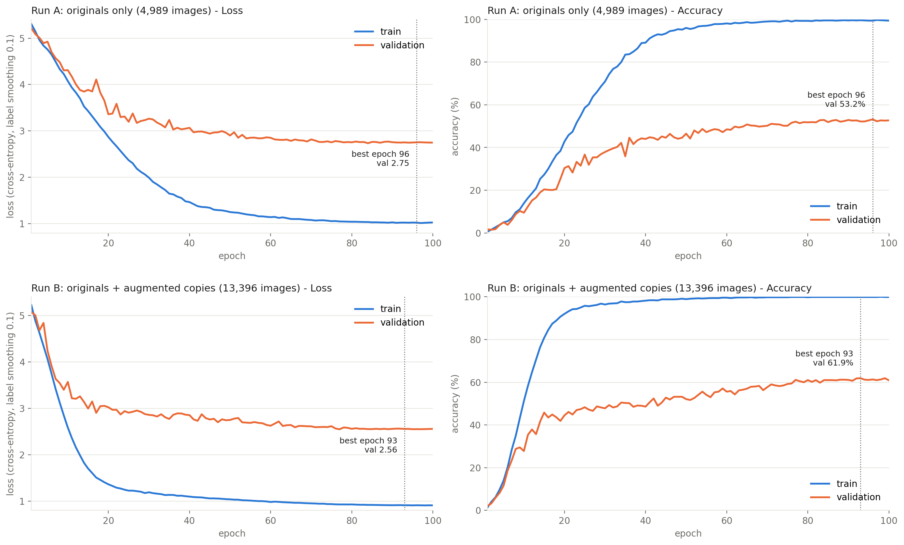

# Task 1.2 — Image Classification & Encoder Training

Goal: train a CNN encoder for 200-class bird classification, first from scratch (baseline), then with
transfer learning, tune it, track it, and explain it with Grad-CAM.

This document reports **what is actually in the repository**. Where a deliverable has code but no recorded
result, it says so in a **Gap** note rather than inventing a number.

**Status at a glance**

| Deliverable | Status |
|---|---|
| From-scratch CNN encoder(s) | Done: ResNet-18, AlexNet, GoogLeNet trained; ResNet-50-D designed |
| Transfer learning vs. from-scratch comparison | Done: VGG16 69.3% vs GoogLeNet 59.5% test |
| Grid Search vs. Random Search | Code done for ResNet; **results recorded for GoogLeNet only** |
| Experiment tracking | Done (MLflow for ResNet, W&B for AlexNet) |
| Grad-CAM | Done (`src/visualization/gradcam.py`; figures in notebook outputs) |

---

## 1. Shared setup

All models use the same data and split from Task 1.1 (`docs/task_1_1_data_understanding.md`).

| | |
|---|---|
| Train | 4,989 originals (Run A) or 13,396 originals + augmented copies (Run B) |
| Validation | 1,000 originals (5 per class), grouped by `original_id` |
| Test | 5,794 images (`Multimodal-Fatima/CUB_test`), used once at the end |
| Input | 224×224, random-resized-crop (0.35–1.0), flip, light colour jitter |
| Optimiser | AdamW, no weight decay on biases/BatchNorm, linear warm-up then cosine decay |
| Regularisation | label smoothing 0.1, dropout, early stopping, mixed precision on GPU |
| Metrics | top-1 accuracy, macro precision / recall / F1, confusion matrix, worst classes (`src/evaluation/`) |
| Seed | 42 |

Every encoder returns the feature maps of its stages (`c1`..`c5`) so the same encoder can later be reused
for colorization and captioning. Code is in `src/models/encoders/`; the registry is `src/models/registry.py`.

---

## 2. From-scratch CNN encoders (baseline)

Three architectures were trained from random weights.

| Model | Parameters | Trained on | Epochs | Val acc | Test acc | Test macro-F1 | Where |
|---|---:|---|---:|---:|---:|---:|---|
| ResNet-18 style, ×0.5 width (Run A) | 2.85 M | originals | 100 | 53.2% | not in repo | – | `configs/cls_scratch.yaml` |
| ResNet-18 style, ×0.5 width (Run B) | 2.85 M | originals + copies | 100 | **61.9%** | not in repo | – | `configs/cls_scratch.yaml` |
| AlexNet (BatchNorm, 4096-d FC) | 59.1 M | originals + copies | 80 | 33.7% | 33.1% | 0.325 | `configs/cls_alexnet.yaml`, `notebooks/AlexNet.ipynb` |
| GoogLeNet / Inception-v1, ×1.0 | 6.19 M | originals + copies | 35 | 59.2% | **59.5%** | 0.590 | `notebooks/kaggle-train-googlenet.ipynb` |

Sources: ResNet validation numbers are from `docs/cnn_encoder_architecture.md` (the run outputs themselves are
not committed); AlexNet from the executed `notebooks/dl-phase1-alexnet.ipynb`; GoogLeNet from the executed
`notebooks/kaggle-train-googlenet.ipynb`. AlexNet trained for 48 min on a Tesla T4; GoogLeNet epochs took about
47 s each.

### Architectures

- **ResNet-18 style** (`scratch_resnet.py`): stem of three 3×3 convs, 4 stages of 2 residual blocks, global
  average pooling, dropout 0.3, linear layer. Default width ×0.5 (channels 32-64-128-256).
- **AlexNet** (`alexnet.py`): five conv layers with BatchNorm, two 4096-unit FC layers with dropout 0.5.
- **GoogLeNet** (notebook): Inception blocks with BatchNorm instead of LRN; `width_mult` 0.5 (1.6 M) or 1.0 (6.2 M).
- **ResNet-50-D** (`notebooks/resnet50d_encoder.ipynb`, `docs/cnn_encoder_architecture.md`): a proposed
  larger encoder (23.9 M parameters). **Proposal only: no accuracy has been measured.**

### What the results show

- **Parameter count does not predict accuracy.** AlexNet has by far the most parameters (59 M) and the worst
  result (33% test). The 6 M-parameter GoogLeNet reaches 59.5%.
- **The models memorise the training set.** GoogLeNet ends at 99.1% train vs. 59.2% val accuracy; AlexNet at
  97.9% train vs. 33.7% val; ResNet-18 Run B shows a gap of about 38 points. With about 25 images per class,
  generalisation, not capacity, is the bottleneck.
- **Offline augmentation helped the ResNet:** Run B beat Run A by 8.7 points of validation accuracy
  (caveat: Run B also takes about 2.7× more optimiser steps per epoch).
- **Weakest classes** (AlexNet, test): Sayornis (3%), Lincoln Sparrow (3%), Laysan Albatross (7%),
  Mockingbird (7%), Pomarine Jaeger (7%), i.e. visually similar fine-grained species.

Training curves for the ResNet runs:



Individual curves: `reports/figures/task1_2/run_A_acc.png`, `run_A_loss.png`, `run_B_acc.png`, `run_B_loss.png`.

> **Gap:** the ResNet-18 baseline has no recorded test-set evaluation in the repo (`outputs/` is not
> committed). Run `python -m src.cli evaluate --task classification --checkpoint <best.pt> --split test`
> on the Kaggle checkpoint to fill the table.

---

## 3. Transfer learning and comparison with from-scratch

> The chosen final model is the pretrained VGG classifier; see `docs/final_model_vgg_classifier.md`.

### What exists

- `configs/vgg_classification.yaml`, `src/models/encoders/vgg.py`, `src/models/vgg_classifier.py`,
  `src/training/train_vgg.py`, `notebooks/vggclassifier.ipynb`: **pretrained VGG13 / VGG16 / VGG19**
  (ImageNet weights) with a 200-class head.
- Two-phase recipe: **phase 1** trains only the new head with the convolutional blocks frozen
  (5 epochs, lr 3e-4); **phase 2** fine-tunes everything with a much smaller step (10 epochs, lr 1e-5);
  label smoothing 0.1, dropout 0.5, mixed precision, early stopping, best checkpoint kept by validation accuracy.
- `src/evaluation/vgg_report.py` and `src/visualization/vgg_plots.py` produce a per-model results table
  (`comparison_test.csv`), a test-accuracy bar chart, and training curves.
- `docs/fine_grained_model_architecture.md`: a design proposal (pretrained Swin-Base + PIM module) for
  reaching the highest accuracy.

### Results (from `notebooks/vggclassifier.ipynb`, Tesla T4, originals only)

| Model | Init | Val acc | Test top-1 | Test top-5 | Params | Train time |
|---|---|---:|---:|---:|---:|---:|
| GoogLeNet ×1.0 (best from scratch) | random | 59.2% | 59.5% | – | 6.2 M | about 27 min (35 epochs × 47 s) |
| VGG13 | ImageNet | 68.1% | 66.83% | 90.47% | 129.8 M | 28.4 min |
| **VGG16** | ImageNet | **69.6%** | **69.26%** | **92.01%** | 135.1 M | 28.5 min |
| VGG19 | ImageNet | 69.3% | 68.78% | 91.53% | 140.4 M | 21.9 min |

Transfer learning beats the best from-scratch model by about 10 points of test accuracy (59.5% → 69.3%) and
overfits far less (VGG16 train 81.7% vs val 69.3%). Full analysis in `docs/final_model_vgg_classifier.md`.
This is still below the 85% working target.

---|---|---:|---:|---:|---:|
| GoogLeNet ×1.0 (best from scratch) | random | 59.2% | 59.5% | 6.2 M | measured |
| VGG13 / VGG16 / VGG19 | ImageNet | *to fill* | *to fill* | 130–140 M | *to fill* |

For context only (published numbers, **not our results**): plain pretrained ResNet-50 reaches about
84.5–88.2% on CUB, while the best from-scratch ResNet-50 results in the literature are about 52–71%. A
large gain over our 59.5% baseline is therefore expected.

---

## 4. Hyperparameter tuning: Grid Search vs. Random Search

### Implementation (`src/tuning/search.py`, `configs/tune_scratch.yaml`)

Both methods get the **same budget and conditions**: 12 trials × 12 epochs, originals only, same split and
seed, no checkpoints. Each trial is logged as its own tracked run (`group=tune_grid` / `tune_random`), results
are appended after each trial so an interrupted search resumes, and `compare-tuning` summarises both.

| | Grid | Random |
|---|---|---|
| Learning rate | 3e-4, 1e-3, 3e-3 | log-uniform 1e-4 – 5e-3 |
| Weight decay | 0.01, 0.05 | log-uniform 1e-3 – 0.1 |
| Width multiplier | 0.5, 1.0 | choice {0.5, 1.0} |
| Dropout | – | uniform 0 – 0.5 |
| Trials | 3×2×2 = 12 | 12 |

```bash
python -m src.cli tune --task classification --config configs/tune_scratch.yaml --method grid
python -m src.cli tune --task classification --config configs/tune_scratch.yaml --method random
python -m src.cli compare-tuning --task classification --results-dir outputs/tuning
```

> **Gap:** the ResNet tuning results (`outputs/tuning/*_results.json`) are not committed, so there is no
> recorded comparison for the ResNet.

### Recorded results: GoogLeNet (6 trials per method, 6 epochs each)

Run in `notebooks/kaggle-train-googlenet.ipynb` on a Tesla T4.

| Grid trial | lr | wd | width | Val acc | Time |
|---:|---:|---:|---:|---:|---:|
| 1 | 5e-4 | 0.01 | 0.5 | 7.5% | 1.84 min |
| 2 | 5e-4 | 0.01 | 1.0 | 16.9% | 1.92 min |
| 3 | 5e-4 | 0.05 | 0.5 | 8.7% | 1.83 min |
| 4 | 5e-4 | 0.05 | 1.0 | 16.1% | 1.91 min |
| 5 | 1e-3 | 0.01 | 0.5 | 12.5% | 1.80 min |
| 6 | 1e-3 | 0.01 | 1.0 | **20.4%** | 1.90 min |

| Random trial | lr | wd | width | dropout | Val acc | Time |
|---:|---:|---:|---:|---:|---:|---:|
| 1 | 1.2e-4 | 0.0015 | 1.0 | 0.28 | 5.8% | 1.88 min |
| 2 | 2.7e-3 | 0.056 | 1.0 | 0.36 | 17.6% | 1.90 min |
| 3 | 3.7e-4 | 0.051 | 0.5 | 0.24 | 5.4% | 1.77 min |
| 4 | 9.0e-4 | 0.025 | 0.5 | 0.20 | 10.5% | 1.80 min |
| 5 | 5.5e-4 | 0.0015 | 1.0 | 0.22 | **17.7%** | 1.91 min |
| 6 | 3.4e-4 | 0.0079 | 0.5 | 0.23 | 5.8% | 1.81 min |

**Comparison**

| | Grid Search | Random Search |
|---|---:|---:|
| Trials | 6 | 6 |
| Best validation accuracy | **20.4%** | 17.7% |
| Total time | about 11.2 min | about 11.1 min |
| Time per trial | about 1.9 min | about 1.9 min |

**Reading it.** Winner: grid, lr 1e-3, weight decay 0.01, width 1.0 (dropout fixed at 0.3). Both methods cost
the same time, since each trial is a fixed 6-epoch run, so the comparison is purely about the score reached
for the budget. The clearest signal in both tables is that **width 1.0 beats width 0.5** (five of the six width-1.0
trials scored 16–20%; the exception used a very low learning rate, 1.2e-4, and scored 5.8%. No width-0.5 trial
exceeded 12.5%). Grid won here because the six-point grid happened to
include the best learning rate (1e-3), while the six random draws never landed near it. With only 6 trials and
a single seed, the 2.7-point difference is **not statistically meaningful**; the usual argument for random
search (more distinct values per parameter, better for large spaces) cannot show up in a grid this small.
Short 6-epoch scores also underestimate final accuracy: the winning configuration reached 59.2% when trained
for 35 epochs.

---

## 5. Experiment tracking

`src/tracking/logger.py` provides one interface with three backends, selected by `tracking.backend`:
`mlflow` (default, local store, no account), `wandb`, or `none`.

Every run logs:

| What | How |
|---|---|
| Hyperparameters | full flattened config as run parameters |
| Metrics | train/val loss and accuracy, learning rate, per epoch |
| Curves | training-curve plots as images/artifacts |
| Final summary | best val accuracy, best epoch, evaluation metrics |
| Checkpoints | `best.pt` (and `last.pt` for resuming) in the run folder; optionally uploaded to the tracker (`log_checkpoint: true`) |
| Tuning trials | one tracked run per trial, tagged by method |

```bash
mlflow ui --backend-store-uri sqlite:///outputs/mlflow.db     # then open http://127.0.0.1:5000
```

- The ResNet pipeline defaults to MLflow (switched from W&B to avoid needing an account).
- The AlexNet run in `notebooks/dl-phase1-alexnet.ipynb` was logged to **Weights & Biases**.
- The GoogLeNet notebook writes local files only (checkpoints, `metrics.json`, comparison PNGs) and has no tracker.

> **Gap:** the MLflow store (`outputs/mlflow.db`) is not committed, so reviewers cannot open the ResNet runs
> from the repo alone. If the report must show the tracking UI, attach screenshots or the Kaggle output.

---

## 6. Model explainability: Grad-CAM

`src/visualization/gradcam.py` implements Grad-CAM (Selvaraju et al., 2017):

1. forward pass; take the score of the target class (by default the predicted class);
2. back-propagate it to the feature maps of the last convolutional stage;
3. average the gradients over space to get one weight per channel;
4. take the weighted sum of the feature maps, apply ReLU, upsample to image size and normalise to [0, 1];
5. overlay as a heatmap on the de-normalised image.

It produces separate figures for **correct** and **wrong** predictions (`run_gradcam(..., n_correct=8,
n_wrong=8)`), saved under `<run>/gradcam_<split>/`:

```bash
python -m src.cli gradcam --task classification --checkpoint outputs/classification/<run>/best.pt --split test
```

Executed Grad-CAM figures (correct and wrong predictions) are embedded in the outputs of
`notebooks/dl-phase1-alexnet.ipynb` (AlexNet, layer conv5) and `notebooks/kaggle-train-googlenet.ipynb`
(GoogLeNet, stage 5). Open those notebooks to see them.

> **Gap:** no interpretation of the heatmaps is written down, and the heatmaps were not exported as separate
> image files. For the report, pick 2–3 correct and 2–3 wrong examples and note whether the model attends to
> the bird (head, bill, plumage) or to background cues such as water, branches or sky. Attention to background
> on wrong predictions is the typical failure explanation for fine-grained data.

---

## 7. Reproducing everything

```bash
pip install -r requirements.txt

# Baselines
python -m src.cli train --task classification --config configs/cls_scratch.yaml                       # Run A
python -m src.cli train --task classification --config configs/cls_scratch.yaml \
    --set experiment.name=scratch_B_augmented data.use_offline_augmented=true                          # Run B
python -m src.cli train --task classification --config configs/cls_alexnet.yaml                       # AlexNet

# Tuning, evaluation, Grad-CAM, comparison
python -m src.cli tune --task classification --config configs/tune_scratch.yaml --method grid
python -m src.cli tune --task classification --config configs/tune_scratch.yaml --method random
python -m src.cli compare-tuning --task classification --results-dir outputs/tuning
python -m src.cli evaluate --task classification --checkpoint <best.pt> --split test
python -m src.cli gradcam  --task classification --checkpoint <best.pt> --split test
python -m src.cli compare-runs --task classification --runs <runA_dir> <runB_dir> --names "A" "B"
```

GoogLeNet and VGG are run from their notebooks. `notebooks/kaggle_train_scratch.ipynb` runs the ResNet
pipeline end to end on Kaggle.

---

## 8. Open items before submission

1. **Raise the pretrained accuracy toward the 85%+ target** (VGG16 is at 69.3%): see the options at the end of
   section 8 of `docs/final_model_vgg_classifier.md`.
2. Evaluate the ResNet-18 Run A / Run B checkpoints on the test split.
3. Re-run or export the ResNet Grid vs. Random tuning results (12 trials each) for a recorded comparison.
4. Write a short interpretation of the Grad-CAM heatmaps.
5. Note in the report that GoogLeNet printed 13,398 training images in its notebook versus 13,396 in the
   ResNet/AlexNet pipeline; the cause was not investigated and should be reconciled.
